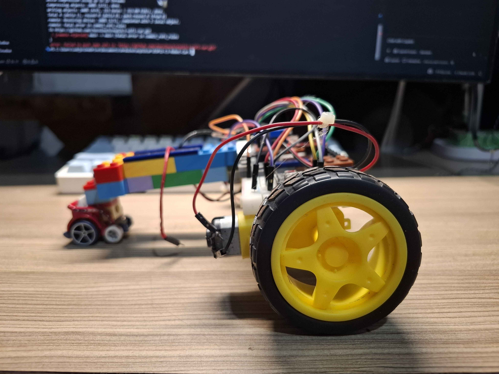
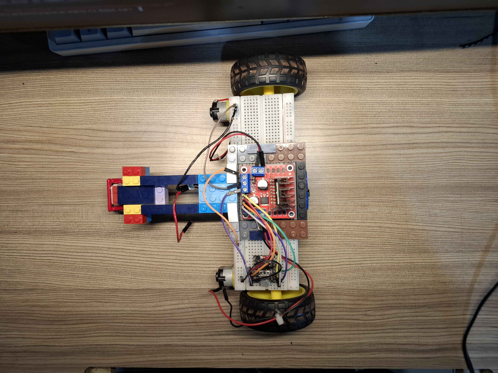

# ESP32-C3 Wi-Fi Robot Car

A two-wheel differential-drive robot car controlled wirelessly through a web-based interface hosted directly on an ESP32-C3.

This project explores embedded systems, wireless communication, motor control, and web-based robotics using affordable and accessible electronics.

<p align="center">
  <strong>ESP32-C3 · Wi-Fi · L298N · Arduino IDE</strong>
</p>

## Project Overview

The robot uses an ESP32-C3 microcontroller to control two DC motors through an L298N dual H-bridge motor driver.

Instead of requiring a dedicated mobile application, the ESP32-C3 creates its own Wi-Fi access point and hosts a webpage that acts as the robot's controller.

Users can connect using a smartphone or computer and control the robot through a browser.

## Features

- Wi-Fi access point hosted by the ESP32-C3
- Browser-based robot controller
- Forward and backward movement
- Left and right turning
- Adjustable motor speed using PWM
- Emergency STOP button
- Automatic motor stop when control commands time out
- No external router or internet connection required

## Hardware Components

| Component | Purpose |
|---|---|
| ESP32-C3 SuperMini | Main microcontroller |
| L298N Motor Driver | Controls the two DC motors |
| 2× TT DC Geared Motors | Robot movement |
| Robot chassis | Mechanical structure |
| Wheels | Locomotion |
| Battery supply | Portable power |

## GPIO Pin Configuration

The following pin configuration connects the ESP32-C3 to the L298N motor driver.

| ESP32-C3 GPIO | L298N Pin | Function |
|---|---|---|
| GPIO 3 | IN1 | Left motor direction |
| GPIO 4 | IN2 | Left motor direction |
| GPIO 5 | IN3 | Right motor direction |
| GPIO 6 | IN4 | Right motor direction |
| GPIO 7 | ENA | Left motor PWM |
| GPIO 10 | ENB | Right motor PWM |
| GND | GND | Common ground |

**Motor connections:**

- OUT1 and OUT2: Left motor
- OUT3 and OUT4: Right motor

## Software and Development Environment

- Arduino IDE
- Arduino ESP32 board package by Espressif Systems
- C++
- Wi-Fi library (`WiFi.h`)
- Web server library (`WebServer.h`)

### Arduino IDE Configuration

| Setting | Configuration |
|---|---|
| Board | ESP32C3 Dev Module |
| USB CDC On Boot | Enabled |
| Programming Language | C++ |
| PWM Frequency | 2000 Hz |
| PWM Resolution | 8-bit |

## Getting Started

### 1. Clone the repository

```bash
git clone https://github.com/chocolouch/esp32c3-wifi-car.git
```

### 2. Open the project

Open the Arduino sketch in Arduino IDE.

### 3. Configure the board

Select:

- Board: ESP32C3 Dev Module
- USB CDC On Boot: Enabled

### 4. Upload the firmware

Connect the ESP32-C3 through USB, compile the sketch, and upload it.

### 5. Connect to the robot

After startup, the ESP32-C3 creates a Wi-Fi access point.

Default configuration:

| Setting | Value |
|---|---|
| Wi-Fi SSID | RobotCar-C3 |
| Password | robot123 |
| Controller URL | http://192.168.4.1 |

Connect your smartphone or computer to the robot's Wi-Fi network and open the controller URL in a browser.

Change the default password before sharing or deploying the project.

## How It Works

The system follows a simple control architecture:

1. The ESP32-C3 initializes its GPIO pins and PWM outputs.
2. The ESP32-C3 starts a Wi-Fi access point.
3. A built-in web server hosts the controller interface.
4. The browser sends movement commands through HTTP requests.
5. The ESP32-C3 processes the commands and controls the L298N.
6. The L298N drives the motors according to the requested direction and speed.

## Photos
<p align="center">
  
  
</p>

## Safety and Power Notes

- Use a properly regulated power supply suitable for the ESP32-C3.
- Ensure motor voltage stays within the motors' rated operating range.
- The L298N is a motor driver, not a voltage regulator.
- Never connect an unregulated battery supply directly to the ESP32-C3 5V input.
- Use an appropriately protected battery system.

## Project Status

**Completed — Functional Prototype**

The ESP32-C3 Wi-Fi Robot Car has been successfully assembled and programmed. Its browser-based controller communicates with the ESP32-C3 over Wi-Fi, allowing wireless movement control through a smartphone or computer.

The physical motors have been tested, and the robot responds to movement commands.

## Project Outcome

This project demonstrates the integration of:
- ESP32-C3 embedded programming
- Wi-Fi communication and access point configuration
- HTTP-based web control
- PWM motor speed control
- Dual DC motor control using an L298N driver
- Basic differential-drive robotics
